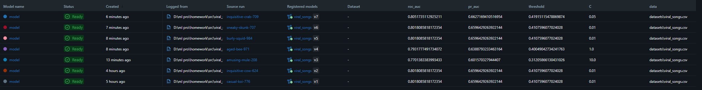
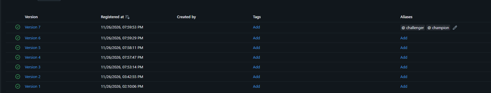
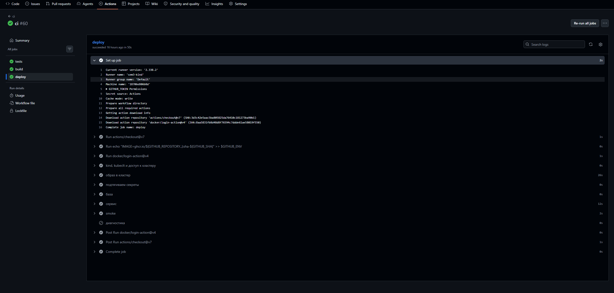
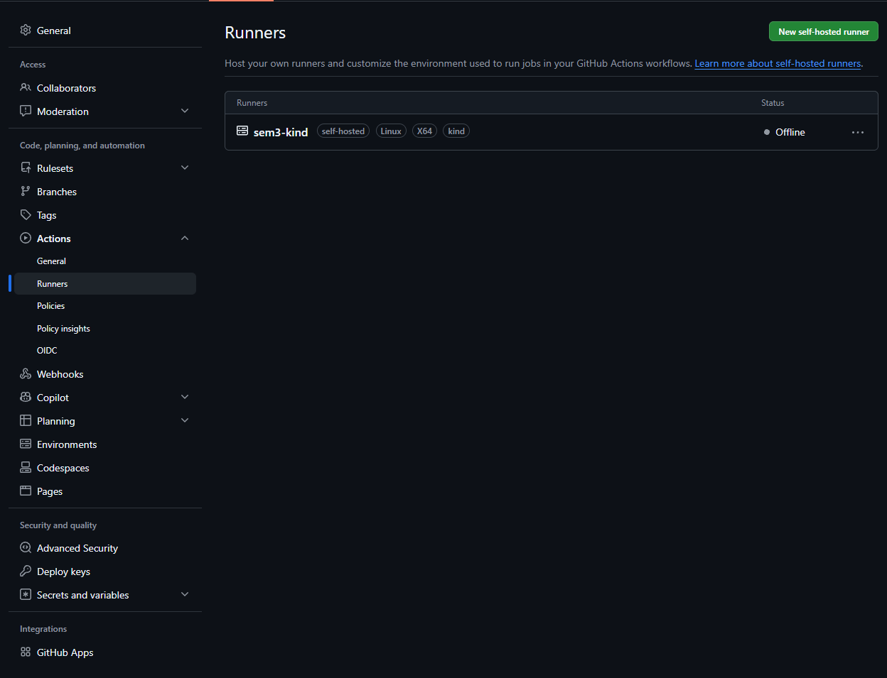
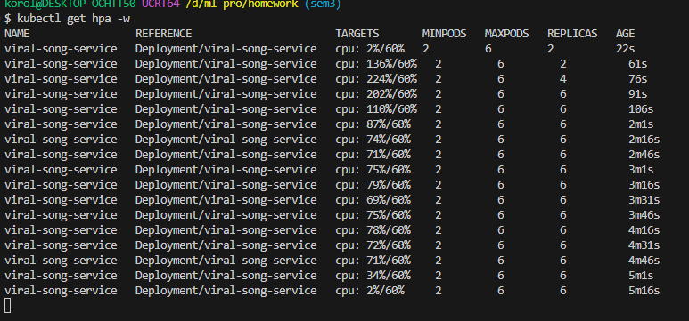
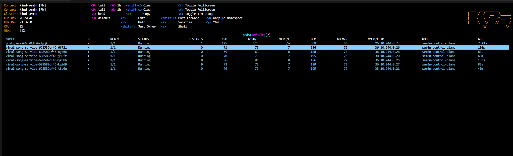
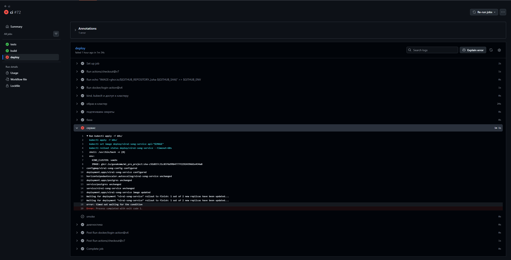

# Отчет ДЗ 3

## 2.1
Вывод kubectl get pods,ingress ‐A. Скрин MLflow на http://mlflow.localhost в режиме Model training.


## 2.2
Скрин страницы модели в Model registry: версии и колонка Aliases. Вывод трёх запусков с решением гейта.




## 2.3
Вывод /health до и после отката, и сколько секунд прошло от клика в UI до ответа старой версии.


## 2.4

Ссылка на зеленый прогон: https://github.com/Gunakemm/ml_pro_project/actions/runs/45839511580




# 2.6 




# 3 Вопросы

1. Почему tests и build по‐прежнему идут в облаке GitHub, а deploy не может? Какие ещё есть способы доставить код в кластер за NAT и почему мы выбрали runner?

Потому что мы явно прописали в манифесте deploy, что мы хотим использовать именно локальный runner

```
   deploy:
    needs: build
    if: github.event_name == 'workflow_dispatch'
    runs-on: [self-hosted, kind]
```

2. Зачем runner запущен с ‐‐network kind, сокетом Docker и ‐‐group‐add 0? Что сломается без каждого из трёх

‐‐network kind: для подключения контейнера с runner в ту же Docker-сеть (kind), где находиться узлы кластреа.
Если этого не прописать, то runner будет запущен в default сети Docker и не будет знать, кто такой sem3n-control-plane

сокет Docker: связывает локальной Docker с Docker внутри runner. И каждый раз, когда runner обращается к докеру, он обращается именно к локальному докеру благадоря сокету. Без него runner не сможет собирать Docker образы и загружать их в Kind.

--group-add 0: Добавляет пользователя внутри контейнера в группу 0, то есть в root, тем самым позволяет runner читать и писать в файл /var/run/docker.sock. Без него получим ошибку отказа в доступе, так как runner не может обраться к сокету

4. Чем challenger отличается от champion? Почему сервис просит алиас, а не номер версии? Сравните откат модели через алиас с откатом кода через rollout undo

champion - это текущая модель в продакшене. Она стабильна и является наилучшей по выбранной метрике.

challenger - это новая модель, которая только что обучилась и имеет показатели по выбранной метрике выше, чем у champion. Однако эта модель еще не рабоатет в продакшене 

Почему сервис просит алиас, а не номер версии? Потому что привязка к номеру версии является жесткой и тогда если у нас появится новая лучшая модель, то придется менять код в конфигах, менять там номер модели на новый, пересобирать образы и перезапускать поды. А так мы просто меняем алиас champion в UI MLFlow и сервис сам подтянет новую модель после перезапуска подов 

rollout undo откатывает именно код, а не саму модель. То есть если мы в прошлой версии брали модель champion, то мы все также возьмем эту модель. Может поменяться только то, как мы работаем с этой моделью под капотом. 

А откат через алиас откатывает нас к предыдущей версии модели, а не кода. То есть с точки зрения сервиса ничего не поменяется, поменяется только модель и ее ответы.


5. Что будет, если задеплоить сервис в кластер, где никто ещё не обучил модель? Как это увидеть в k9s и в логе CI?

Сервис упадет в CrashLoopBackOff и логах пода будет примерно такое сообщение

```
File "/usr/local/lib/python3.11/contextlib.py", line 210, in __aenter__                                                                                                                                                                                                                         │
│     return await anext(self.gen)                                                                                                                                                                                                                                                                  │
│            ^^^^^^^^^^^^^^^^^^^^^                                                                                                                                                                                                                                                                  │
│   File "/app/src/viral_song/service/app.py", line 21, in lifespan                                                                                                                                                                                                                                 │
│     app.state.pipeline, app.state.meta, app.state.version = load_model()                                                                                                                                                                                                                          │
│                                                             ^^^^^^^^^^^^                                                                                                                                                                                                                          │
│   File "/app/src/viral_song/model_store.py", line 15, in load_model                                                                                                                                                                                                                               │
│     mv = MlflowClient().get_model_version_by_alias(settings.model_name, settings.model_alias)                                                                                                                                                                                                     │
│          ^^^^^^^^^^^^^^^^^^^^^^^^^^^^^^^^^^^^^^^^^^^^^^^^^^^^^^^^^^^^^^^^^^^^^^^^^^^^^^^^^^^^                                                                                                                                                                                                     │
│   File "/app/.venv/lib/python3.11/site-packages/mlflow/tracking/client.py", line 5867, in get_model_version_by_alias                                                                                                                                                                              │
│     mv = self._get_registry_client().get_model_version_by_alias(name, alias)                                                                                                                                                                                                                      │
│          ^^^^^^^^^^^^^^^^^^^^^^^^^^^^^^^^^^^^^^^^^^^^^^^^^^^^^^^^^^^^^^^^^^^                                                                                                                                                                                                                      │
│   File "/app/.venv/lib/python3.11/site-packages/mlflow/tracking/_model_registry/client.py", line 475, in get_model_version_by_alias                                                                                                                                                               │
│     return self.store.get_model_version_by_alias(name, alias)                                                                                                                                                                                                                                     │
│            ^^^^^^^^^^^^^^^^^^^^^^^^^^^^^^^^^^^^^^^^^^^^^^^^^^                                                                                                                                                                                                                                     │
│   File "/app/.venv/lib/python3.11/site-packages/mlflow/store/model_registry/rest_store.py", line 516, in get_model_version_by_alias                                                                                                                                                               │
│     response_proto = self._call_endpoint(GetModelVersionByAlias, req_body)                                                                                                                                                                                                                        │
│                      ^^^^^^^^^^^^^^^^^^^^^^^^^^^^^^^^^^^^^^^^^^^^^^^^^^^^^                                                                                                                                                                                                                        │
│   File "/app/.venv/lib/python3.11/site-packages/mlflow/store/model_registry/rest_store.py", line 68, in _call_endpoint                                                                                                                                                                            │
│     return super()._call_endpoint(                                                                                                                                                                                                                                                                │
│            ^^^^^^^^^^^^^^^^^^^^^^^                                                                                                                                                                                                                                                                │
│   File "/app/.venv/lib/python3.11/site-packages/mlflow/store/model_registry/base_rest_store.py", line 42, in _call_endpoint                                                                                                                                                                       │
│     return call_endpoint(                                                                                                                                                                                                                                                                         │
│            ^^^^^^^^^^^^^^                                                                                                                                                                                                                                                                         │
│   File "/app/.venv/lib/python3.11/site-packages/mlflow/utils/rest_utils.py", line 758, in call_endpoint                                                                                                                                                                                           │
│     response = verify_rest_response(                                                                                                                                                                                                                                                              │
│                ^^^^^^^^^^^^^^^^^^^^^                                                                                                                                                                                                                                                              │
│   File "/app/.venv/lib/python3.11/site-packages/mlflow/utils/rest_utils.py", line 460, in verify_rest_response                                                                                                                                                                                    │
│     raise RestException(json.loads(response.text))                                                                                                                                                                                                                                                │
│ mlflow.exceptions.RestException: RESOURCE_DOES_NOT_EXIST: Registered Model with name=viral-songs not found                                                                                                                                                                                        │
│                                                                                                                                                                                                                                                                                                   │
│ ERROR:    Application startup failed. Exiting.                                                                                                                                                                                                                                                    │
│ stream closed: EOF for default/viral-song-service-7d55779bcd-jmlfb (api)                                                                                                                                                                                                                          │
│                  
```                                                            



```
kubectl get pods -A
NAMESPACE            NAME                                                  READY   STATUS             RESTARTS       AGE
default              postgres-765d79d876-tgjkq                             1/1     Running            2 (104m ago)   19h
default              viral-song-service-574686fd56-x9kfc                   0/1     CrashLoopBackOff   2 (20s ago)    40s
default              viral-song-service-7d55779bcd-jmlfb                   1/1     Running            0              95m
default              viral-song-service-7d55779bcd-tp4kc                   1/1     Running            0              95m
kube-system          coredns-559f6c778d-b64xj                              1/1     Running            2 (104m ago)   24h
kube-system          coredns-559f6c778d-zdtql                              1/1     Running            2 (104m ago)   24h
kube-system          etcd-sem3n-control-plane                              1/1     Running            2 (104m ago)   24h
kube-system          kindnet-5q9gv                                         1/1     Running            2 (104m ago)   24h
kube-system          kube-apiserver-sem3n-control-plane                    1/1     Running            2 (104m ago)   24h
kube-system          kube-controller-manager-sem3n-control-plane           1/1     Running            2 (104m ago)   24h
kube-system          kube-proxy-5kh99                                      1/1     Running            2 (104m ago)   24h
kube-system          kube-scheduler-sem3n-control-plane                    1/1     Running            2 (104m ago)   24h
kube-system          metrics-server-7775f4c4b6-qmchn                       1/1     Running            2 (104m ago)   12h
local-path-storage   local-path-provisioner-75f7fc7dc5-5b74c               1/1     Running            4 (103m ago)   24h
mlops                airflow-76cc4bf974-vr94d                              1/1     Running            2 (104m ago)   22h
mlops                mlflow-9f98c4469-zdzpp                                1/1     Running            2 (104m ago)   24h
monitoring           monitoring-grafana-8694d54467-gqvv6                   3/3     Running            6 (104m ago)   23h
monitoring           monitoring-kube-prometheus-operator-55c8d7b6d-bflnd   1/1     Running            4 (104m ago)   23h
monitoring           monitoring-kube-state-metrics-78fd56fc4b-9crm5        1/1     Running            4 (104m ago)   23h
monitoring           prometheus-monitoring-kube-prometheus-prometheus-0    2/2     Running            4 (104m ago)   23h
traefik              traefik-6d9c545874-gkcjh                              1/1     Running            2 (104m ago)   23h
```

6. Проследите запрос от браузера до пода MLflow: какие порты и какие компоненты он проходит? 
Зачем MLflow нужны ‐‐allowed‐hosts и ‐‐cors‐allowed‐origins, и почему порт 80 
задаётся при создании кластера, а не потом?

mlflow.localhost(127.0.0.1:80) с заголовком Host: mlflow.localhost -> 
Docker перехватывает пакет на порту 80 и прокидывает его внутрь контейнера sem3n-control-plane на порт 30080 ->
Traefik установлен как NodePort на порту 30080 и запрос направляется в него ->
Traefik видит заголовок Host: mlflow.localhost и по своим правилам (Ingress) определяет, 
в какой сервис переправить запрос, а именно отправить его в mlflow на порту 5000 ->
kube-proxy подменяет виртуальный IP на реальный IP пода mlflow и уже внутри mlflow сервис 
принимает запрос на порту 5000

--allowed-hosts.
Изначально веб-сервер, где работает mlflow, доверяет только localhost. И когда Traefik передает запрос с 
заголовком Host: mlflow.localhost, mlflow может вернуть ошику 400 Bad Request. Флаг --allowed-hosts 
говорит серверу доверять запросам с именем mlflow.localhost

--cors-allowed-origins
Веб-интерфейс MLflow (это React-приложение) при загрузке делает множество фоновых API-запросов
 (чтобы получить список экспериментов, графики и т.д.). Браузер применяет политику CORS 
 (Cross-Origin Resource Sharing). Если MLflow не разрешит запросы с этого домена, в консоли 
 браузера ты увидишь красные ошибки CORS, а UI будет пустым. 
 Флаг разрешает браузеру делать эти запросы.

 Порты 80 задается при создании кластера, потому что Docker устроен таким образом, 
 что нельзя прокинуть порт в уже запущенный контейнер. Поэтому порт необходимо прописывать в 
 конфиге при поднятии контейнера. Если порт не прокинуть, то в браузере порт 80 будет просто
 не доступен, так как кластер по сути поднят, внутри него все работает, но достучаться к 
 нему из вне невозможно


 7. Посчитайте по формуле из лекции 3.1, сколько реплик HPA должен был выставить при вашей
загрузке CPU, и сравните с тем, что он выставил. Почему вниз реплики уходили дольше, чем вверх?

%CPU в моменте достигал 220%, а цель 60%.
Следовательно необходимо было поднять [2 * 220 / 60] = 8 подов. Однако в maxReplicas: 6, поэтому 
поднялось все 6 доступных реплик и нагрузка на каждый под снизилась до 80%. 

Если поднимаются поды быстро (HPA раз в 15 секунд смотрит на метрику и правит число реплик у Deployment),
однако поднимаются поды все равно не все сразу, а постепенно, проходя этапы проверки метрики, размещение пода,
старт контейнера, загрузки модели в контейнер, readiness.
Но уходят реплики не сразу, так как у HPA есть окно стабилизации, по умолчанию 5 минут, в течении которых
созданные поды продолжают жить, и лишь затем постепенно начнут опускаться контейнеры и выключаться поды.

8. Что лежит в git, а что в хранилище DVC? По шагам: как восстановить ровно те данные, на
которых обучена версия N вашей модели в реестре?

В git лежит только код. Никакие данные или модели в git не храняться. Данные храняться в S3 или другом 
хранилище. В гите храниться файл .dvc, внутри которого хеш данных, размер и путь. Модели храняться в 
MLFlow и там храняться только веса, метрики и хеш данных, на которых она была обучена. И нам необходимо 
имея модель и хеш данных найти связь с git коммитом (в идеале, конечно, еще в mlflow хранить git-sha для быстрого доступа к комиту), 
откатиться на этот коммит. После отката на этот коммит, .dvc файл будет содержать нужный нам хеш, который использовался 
при обучении модели.

Ну а в случае, если в MLFlow храним только data_md5, то в гите ищем этот хеш

```
git log -S <data_md5> -- datasets/viral_songs.csv.dvc
```

Получаем commit_hash и переключаемся на этот коммит и делаем dvc pull

```
git checkout <commit_hash>
uv run dvc pull datasets/viral_songs.csv
```