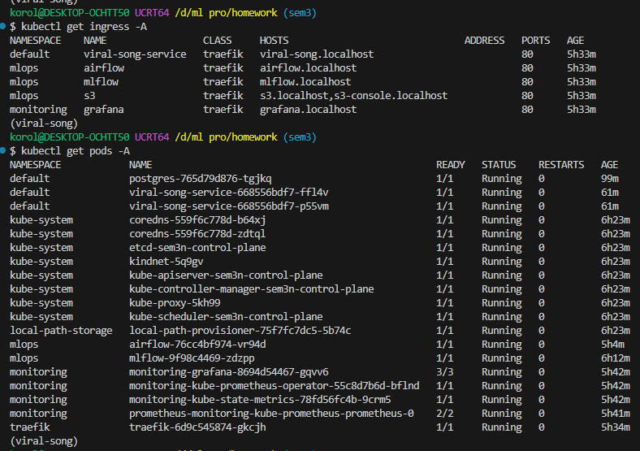
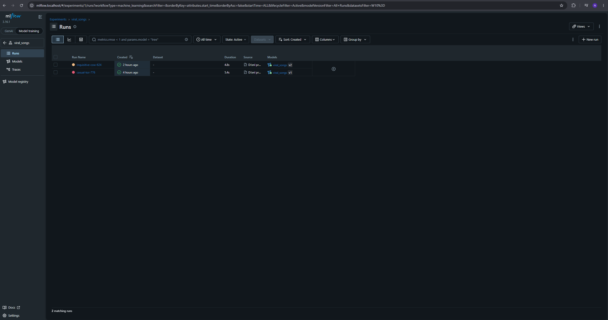
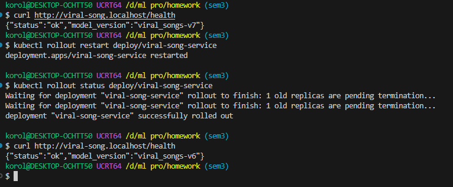

# Отчет ДЗ 3

## 2.1
Вывод kubectl get pods,ingress ‐A. Скрин MLflow на http://mlflow.localhost в режиме Model training.

## 2.2
Скрин страницы модели в Model registry: версии и колонка Aliases. Вывод трёх запусков с решением гейта.

## 2.3
Вывод /health до и после отката, и сколько секунд прошло от клика в UI до ответа старой версии.

## 2.4

Ссылка на зеленый прогон: https://github.com/Gunakemm/ml_pro_project/actions/runs/45839511580

# 2.6 

