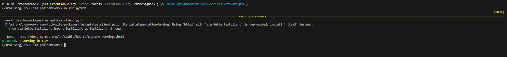
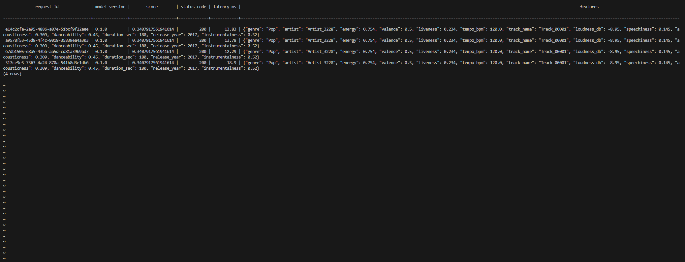
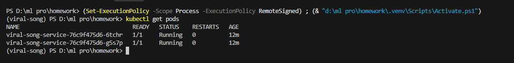
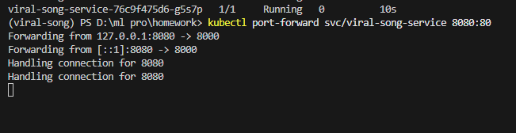
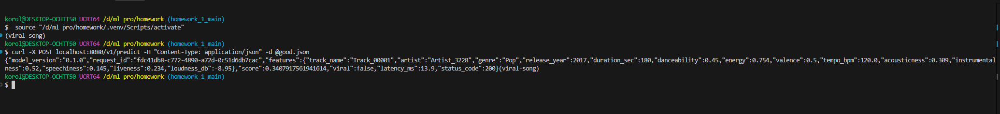
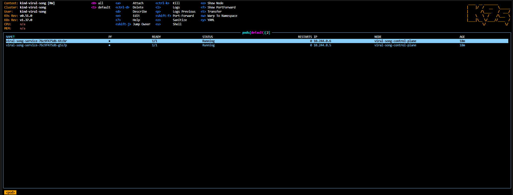

# Отчет ДЗ 1

### 1. pytest

Терминал с выводами pytest

### 2. SELECT из базы данных логов

### 3. kubectl get pods + ответ /v1/predict через port-forward

Поды

Прокинутый порт 80

Предикт после запроса к поду

### 4. k9s с подами

## Журнал проблем
Была одна критическая проблема с установкой докера. 
У меня 2 стационарных компьютера. Домашний на виндовс и рабочий на линукс. На домашнем компьютере wsl установился без проблем, однако докер не запускался. 
До момента запуска любые запросы к wsl через powershell проходили спокойно, однако как только запускался докер, то wsl сразу же зависал без возможности ожить. 
Я перепробовал все возможные советы из гугла и deepseek однако ничего не помогало. Я решил, раз wsl не помогает решить вопрос, то стоит попробовать накатить полноценную машину в VirtulBox.
Перед этим полностью переустановил виндовс (все равно давно хотел, а тут появился повод).

Установил полноценную вируальную машину с ubuntu и уже в ней установил докер. Однако докер просто отказывался запускаться. Связано это с тем, что в такой матрешке появляется вложенная виртуализация 
(как я понял, докеру даже на линуксе нужно полноценное виртуальное окружение. И получается что внутри windows установлена linux, а втрутри этого linux нужен еще один linux).

Тогда я решил еще раз попытать удачу на windows с использованием wsl и, после переустановки винды, все чудесным образом заработало. Дальше на домашнем компьютере проблем не возникало.

На рабочем linux докер установился и запустился сразу. Однако на рабочем компе у меня тоже есть виртуальная машина, только на этот раз с windows. И как-то случайно вышло так, что у меня был запущен докер и был поднят какой-то контейнер.
И уже поднятый контейнер не дал мне в свою очередь запустить виртуальную машину с windows. Не буду утверждать, что причина также связана с какого-то рода вложенной виртуализацией. Возможно компьютер просто не мог выделить ресурсы для виртуаьной машины
или я сделал что-то не то, однако сам факт.

Подводя итог: все проблемы были связаны именно с запуском самого докера и подключением его к виртуальному окружению
